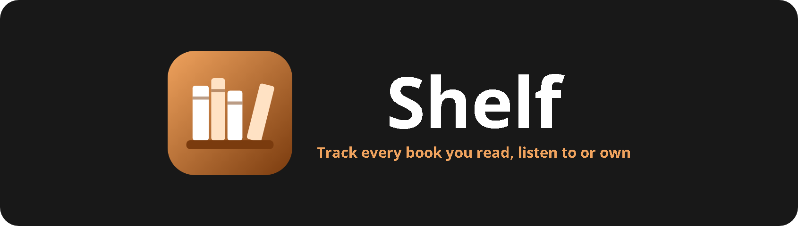
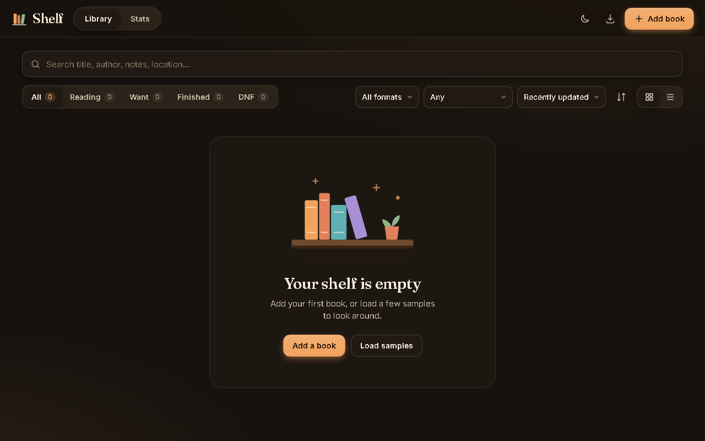

<p align="center"></p>

<p align="center">    </p>

Shelf keeps track of your whole library across three formats: physical books, ebooks and audiobooks. Log what you want to read, what you are reading and what you have finished, look books up automatically, and see your reading stats for the year.

<p align="center"></p>

## Features

- Each book can be physical, ebook, audiobook or any mix
- Status (want / reading / finished / DNF), page or listening progress, star ratings, notes and dates
- Location and "lent to" fields for physical copies
- Search, filters, sorting, and grid or list views
- Open Library lookup by ISBN or title to fill in details and covers, with an offline fallback
- Stats: yearly reading goal and pace, books per month and year, format breakdown, total pages and hours
- JSON and CSV export and import (reads Goodreads-style CSVs), undo after delete, light and dark themes

## Getting started

No build step and no dependencies. Clone the repo and open `index.html`, or serve the folder locally:

```bash
git clone https://github.com/Squidly1408/book-tracker.git
cd book-tracker
python -m http.server 8765
```

Then visit http://localhost:8765.

## Project structure

| File | Purpose |
|---|---|
| `index.html` | App shell |
| `app.js` | Library, lookup, stats, import and export |
| `styles.css` | Styles and themes |
| `assets/` | Logo and README images |

## Built with

HTML, CSS, JavaScript, localStorage, [Open Library API](https://openlibrary.org/developers/api)

## Limitations

- Data is stored in this browser only; use export and import to move it
- Covers are loaded from Open Library, so offline you see generated covers
- A book you both read and listened to counts towards both pages and hours

## License

Released under the [MIT License](LICENSE).
